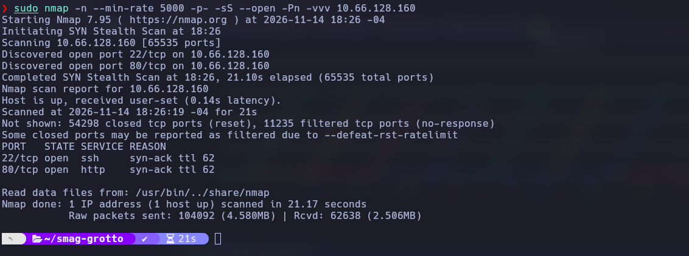
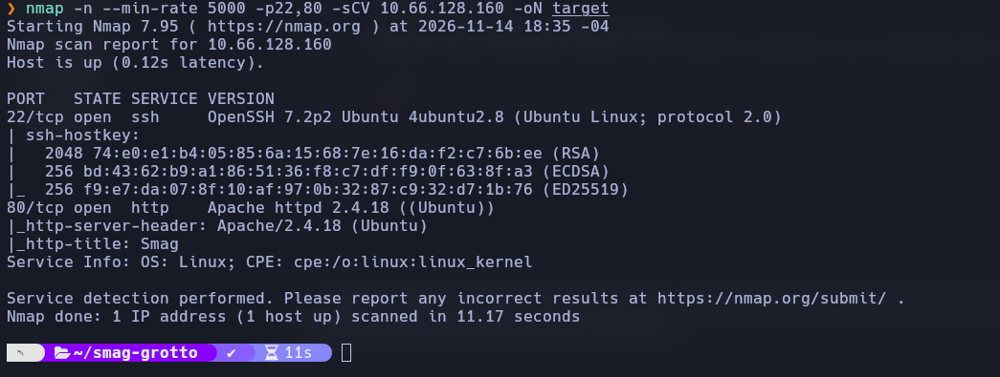
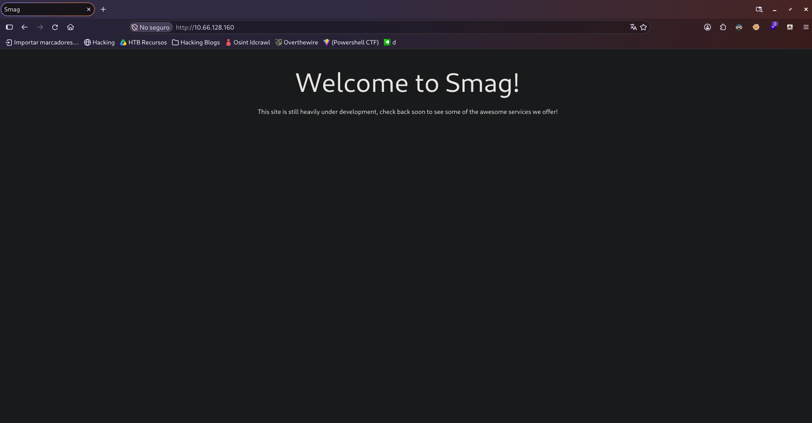
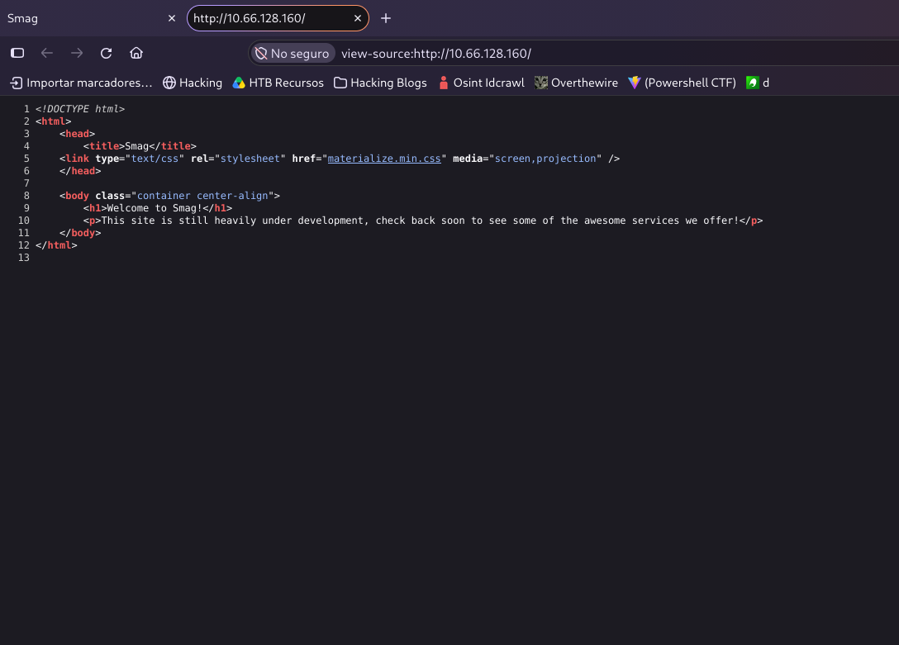
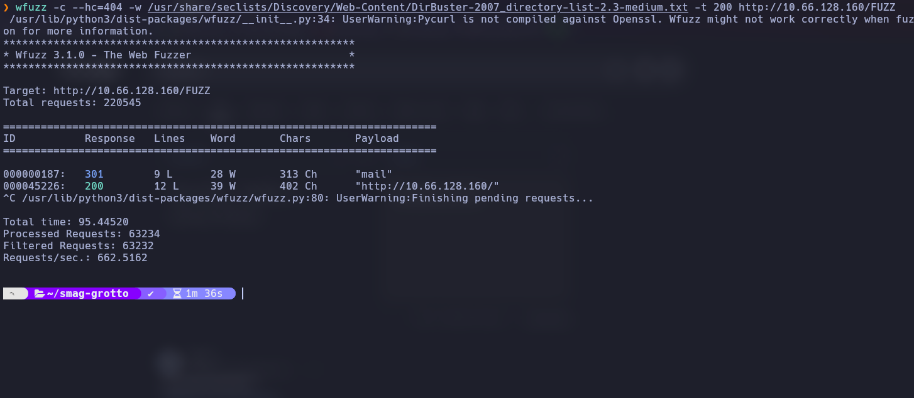
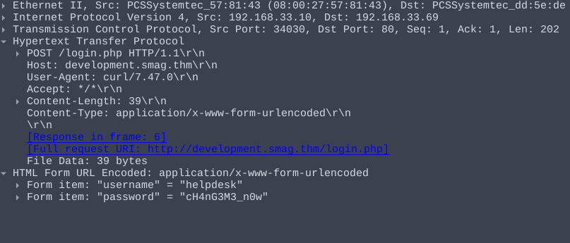

In this post, we will work on the THM machine "Smag Grotto."

First, we will determine whether we have a connection to the target machine.


As we can see, we sent an ICMP trace and received it back; this means we have a connection to the machine.

We will begin scanning the ports using nmap to identify exposed services, with the following command:

```bash
sudo nmap -n --min-rate 5000 -p- -sS --open -Pn -vvv 10.66.128.160
```



As we can see, only ports 22 and 80 are open.

Now that the ports have been scanned, we will perform an exhaustive scan to determine their versions using:

```bash
nmap -n --min-rate 5000 -p22,80 -sCV 10.66.128.160 -oN target
```
As we can see, there is nothing of interest here, so let’s take a look at how the HTTP service is implemented.

Upon entering, we observe the following:



Upon opening the page, we are greeted by the following: Welcome to Smag!



The first thing that came to mind was to do a:

Ctrl + U

To inspect the page and see if there was anything in the comments that might provide a clue.



Well, there wasn't anything interesting; even though there was a CSS file, I checked it, but there’s nothing there—it’s just for the page's decoration.

The next step we’ll take is fuzzing, which helps us discover directories that aren’t visible at first glance.

We will use the tool wfuzz, which is perfect for our needs.

```bash
wfuzz -c --hc=404 -w /usr/share/seclists/Discovery/Web-Content/DirBuster-2007_directory-list-2.3-medium.txt -t 200 http://10.66.128.160/FUZZ
```

Once the fuzzing was complete, we only discovered one directory: mail.



We will access that directory via the URL.


It appears the employees have run into a network issue, and they have also provided us with a pcap file.

We will download it and analyze it.

We will open Wireshark to analyze the pcap.

```bash
sudo wireshark dHJhY2Uy.pcap
```

Upon opening the pcap, we can see all the requests that have been made.


The ones we are interested in are the HTTP protocols.

Since HTTP services do not encrypt the data sent to the server, it can be viewed in clear text.



We can see that we have a subdomain, a username, and a password.

This means that Virtual Hosting is being applied.

To be able to access this domain, we will need to include it in /etc/hosts.


Let's see what this subdomain contains.


Alright! As you can see, we have two resources that we couldn't access when using the IP address.

When attempting to access admin.php, we are redirected to login.php; so, let’s enter the credentials we found.

```bash
helpdesk : cH4nG3M3_n0w
```


Upon logging in, we discover what appears to be a type of webshell.


We tried running some basic commands, but it didn't show us the output.

To verify that it was a webshell, we sent ICMP traces to our own machine.

To do this, we will first set our machine to listen for ICMP traces.

```bash
sudo tcpdump -i tun0 -n icmp
```


Now, from the web shell, we send ICMP traces to verify that we have RCE.


Upon returning to our terminal, we see that we do indeed have RCE!


Now, we will gain access to the machine.
<!--more-->

