Today we will do the Mustacchio machine on TryHackMe.

First, we will check if we have a connection to the machine.

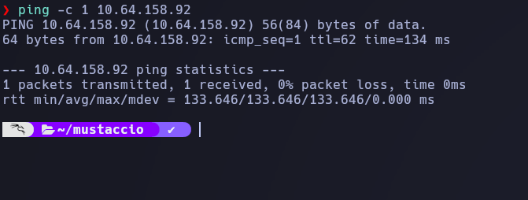

As we can see, we sent an ICMP echo request and got a reply back, so we have connectivity with the machine.

Now we will move on to the reconnaissance phase.

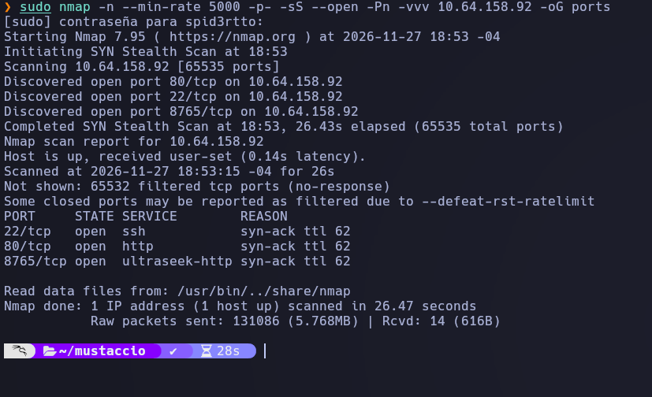

```bash
sudo nmap -n --min-rate 5000 -p- -sS --open -Pn -vvv 10.64.158.92 -oG ports
```

As we can see, Nmap found 3 open ports: 80, 22, and 8765.

I will be exporting it in grepable format to the ports file, because I have a function in my  `.zshrc`  that extracts all the scanned ports from a machine.

In case you want the function, here is the code so you can put it in your .bashrc or .zshrc (depending on which shell you use):

```bash
function getports() {
    if [ -z "$1" ] || [ ! -f "$1" ]; then
        echo "[!] Usage: getports <nmap_greppable_file>"
        return 1
    fi

    ports="$(grep -oP '\d{1,5}/open' "$1" | awk -F'/' '{print $1}' | xargs | tr ' ' ',')"
    ip_address="$(grep -oP '\d{1,3}\.\d{1,3}\.\d{1,3}\.\d{1,3}' "$1" | sort -u | head -n 1)"

    echo -e "\n[*] Extracting information...\n"
    echo -e "\t[*] IP Address: $ip_address"
    echo -e "\t[*] Open ports: $ports\n"

    echo -n "$ports" | xclip -sel clip
    echo -e "[*] Ports copied to clipboard!\n"
}
```

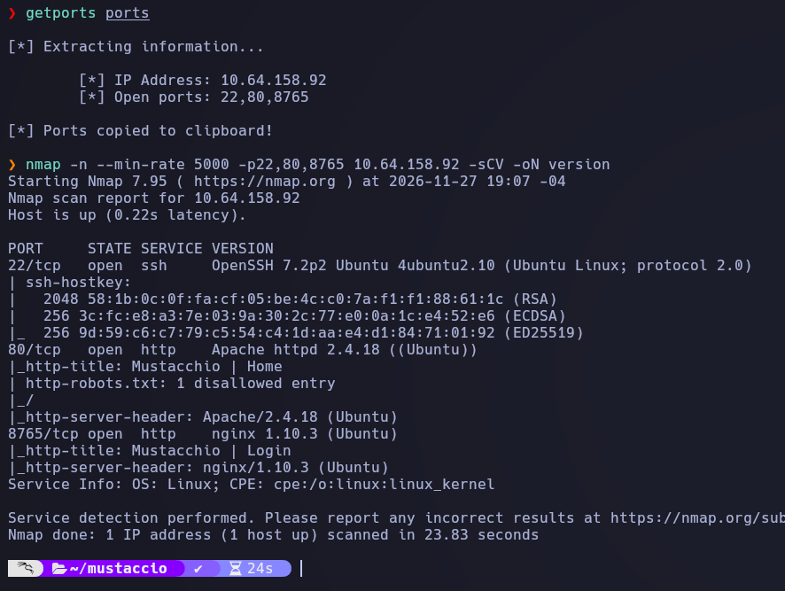

As we can see, these are the port version scan results

First, we will go to port 80 to see what content is hosted on it.


As we can see, at first glance there is nothing interesting.

We will inspect the source code a bit to see if there is anything strange commented out.

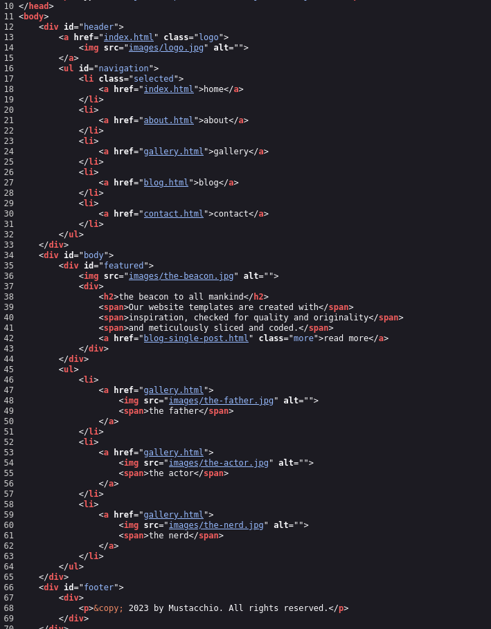

Hmm, nothing interesting apparently.

We go to the "About" section and see that it contains an image and strange words that look like Latin.


Here you might think there When running fuzzing, we find two directories: images and custom. We will go for custom, as it is the one that caught my attention the most.is some strange text hidden between the words, but... no, that's not the case.

Or you might also try downloading this image to see if it has any strange metadata, but that's not it either.

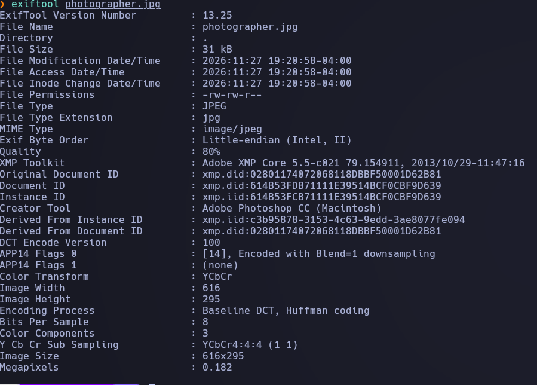

Now we go to the "Gallery" section, where we come across several images.


Here you might think that at least one of the images has to contain something, but no—if you analyze them, you will only waste time.

Let's go to the "Blog" section.


Same thing, we don't see anything interesting.

Finally, we go to the "Contact" section.

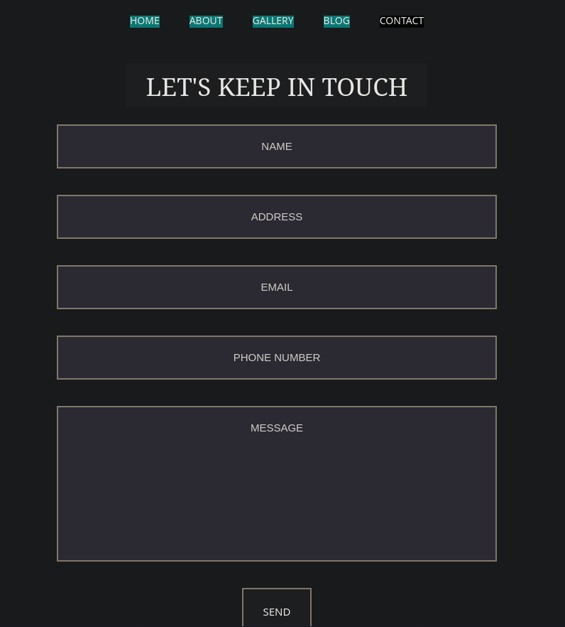

Here we finally see something that breaks the pattern of what we saw earlier.

We test by entering fake data to see where it sends them.

When we submit our fake data, nothing happens—it just appends all the fields and data into the URL.

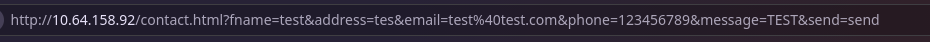

At this point, what we could do is directory fuzzing.

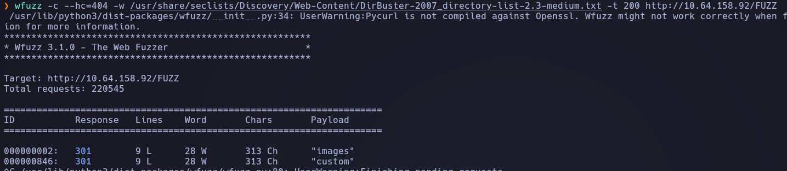

```bash
wfuzz -c --hc=404 -w /your/list.txt -t 200 http://10.64.158.92/FUZZ
```

When running fuzzing, we find two directories: images and custom. We will go for custom, as it is the one that caught my attention the most.

When going to the custom directory, we find 2 folders.

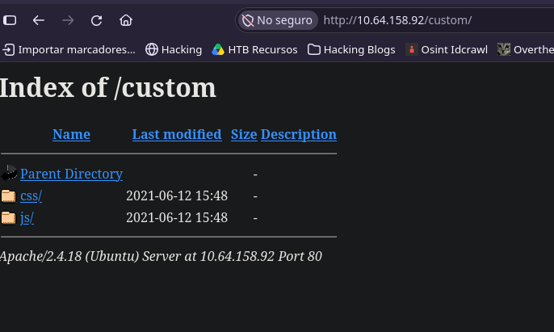

We will go into the css folder first to analyze its contents.

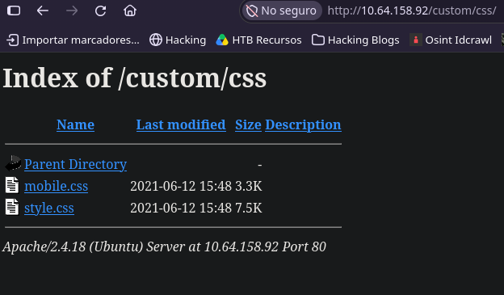

We found 2 .css files, which—to be honest—you shouldn't bother paying attention to, as they are just stylesheets that help improve the look of the page.

But that doesn't mean there couldn't still be something strange left commented out—let's check it just in case.

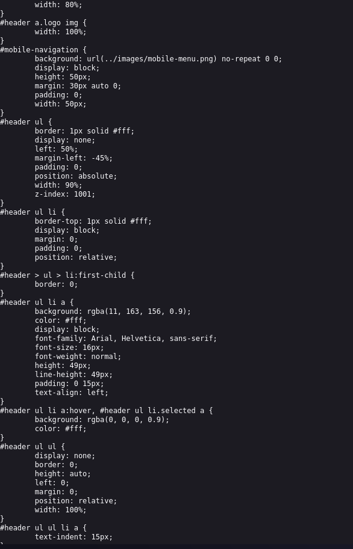

Upon analyzing the  `mobile.css`  file, we didn't find anything unusual.

The same applies to  `style.css`  as well

Alright, lastly, let's go to the js directory.

Well, there’s one particular file here that catches my eye.

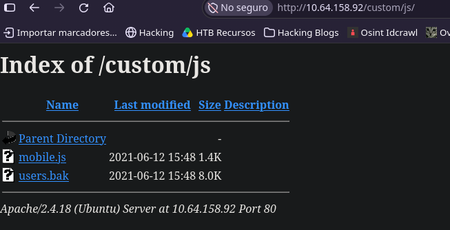

We see the file  `users.bak`  , which, judging by the extension, I assume is a user backup.

Let's download it to analyze it.

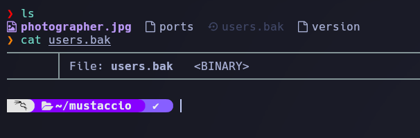

Upon attempting to read the file, we see that it is a binary.

We will use the  `strings`  command to try to read something from the file.

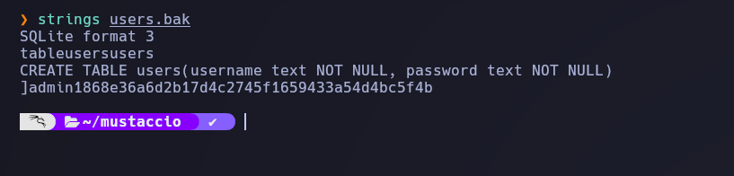

As we can see, it is an sqlite3 file, and further down we can see what appears to be a username and an MD5-hashed password.

Anyway, we can analyze this file with sqlite3, because if we run the file command and specify the file, it reports that it's a SQLite 3 database.

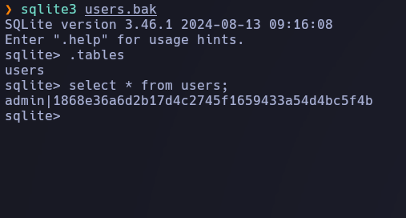

Alright, we have the user admin and this hash : 1868e36a6d2b17d4c2745f1659433a54d4bc5f4b

We can use websites like <https://crackstation.net> to crack this hash.

We'll use this website since it has precomputed hashes, so we don't have to brute-force this hash.

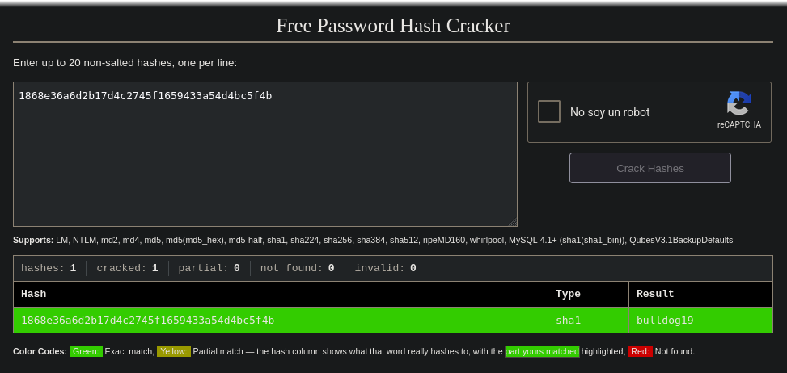

As we can see, CrackStation managed to crack this hash, and the plaintext password is: "bulldog19"

Alright, so the question now is: where can I use these credentials?

Well, if we check our Nmap scan, we can see port 8765—let's take a look at it.

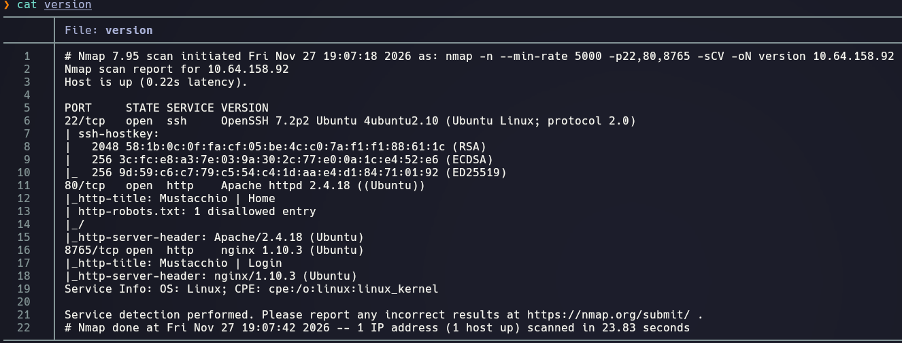

When accessing this web server on port 8765, we are shown this:

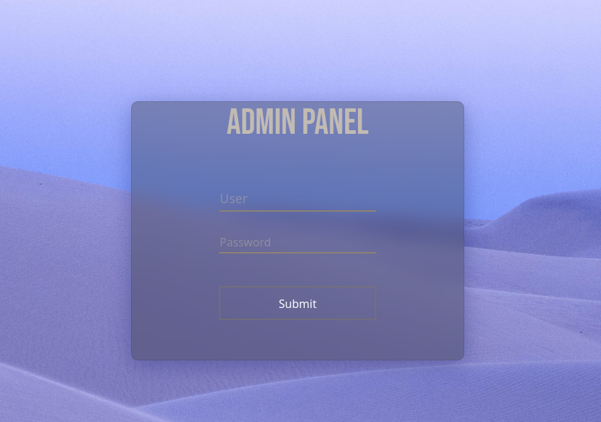

As we can see, it's an admin panel where we could now try entering the credentials we obtained from  `users.bak`  .

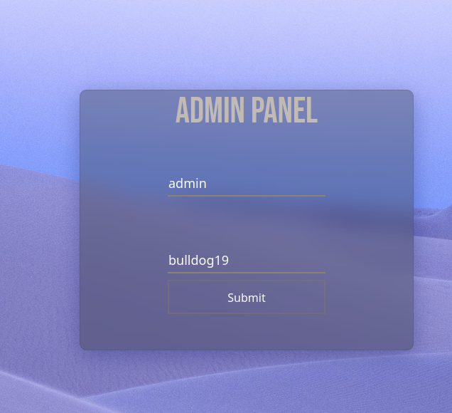

Awesome, we logged into this admin panel with those credentials!
